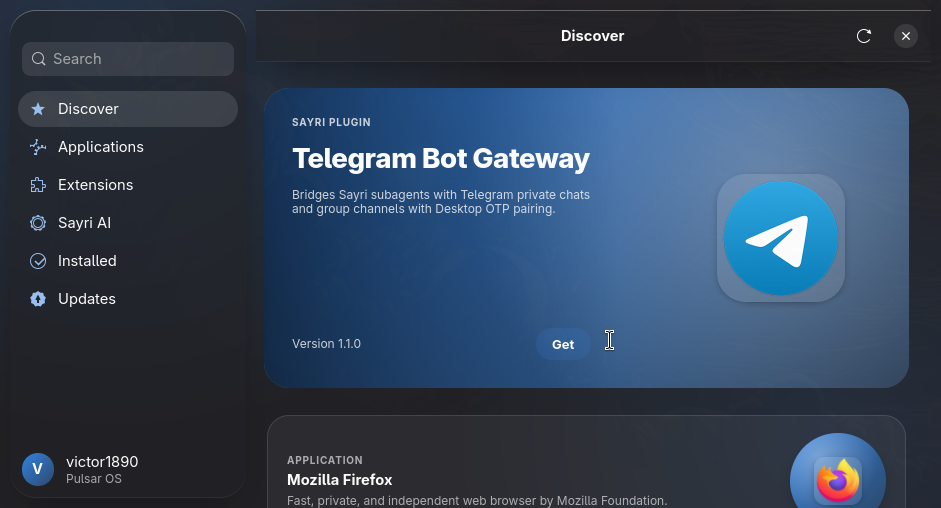

# Pulsar Store

The app store for Pulsar OS. Browse and install Flatpak apps, native packages, GNOME Shell extensions, and Sayri AI skills and plugins from one place.



Written in Rust with GTK4 and libadwaita. It takes inspiration from Apple's Liquid Glass design.

## Build and run

```
cargo run                      # the app
cargo run --bin pulsar-storectl -- search firefox
cargo test
```

Needs GTK 4.14+ and libadwaita 1.5+ (on Arch: `gtk4 libadwaita`; on Debian/Ubuntu: `libgtk-4-dev libadwaita-1-dev`) and `gettext`.

Open a page directly: `pulsar-store --page apps` (also `discover`, `extensions`, `sayri`, `installed`, `updates`, `search:<text>`, `item:<id>`).

## Programs

| Binary | What it does |
|---|---|
| `pulsar-store` | The app |
| `pulsar-storectl` | Command line: search, info, install, uninstall, updates (with `--json`) |
| `pulsar-store-updated` | Background update checker with notifications (systemd user service) |

## Docs

- [Architecture](docs/architecture.md) and [decision records](docs/adr/)
- [Design system](docs/design-system.md)
- [Add a package source](docs/adding-a-source.md)
- [Publish to the catalog](docs/catalog-submission.md)
- [Translating](docs/translating.md)
- [Accessibility](docs/accessibility.md)
- [Threat model](docs/threat-model.md)
- [Performance budget](docs/performance-budget.md)
- [Contributing](CONTRIBUTING.md) and the [ticket backlog](docs/tickets/)

License: GPL-3.0-or-later.
