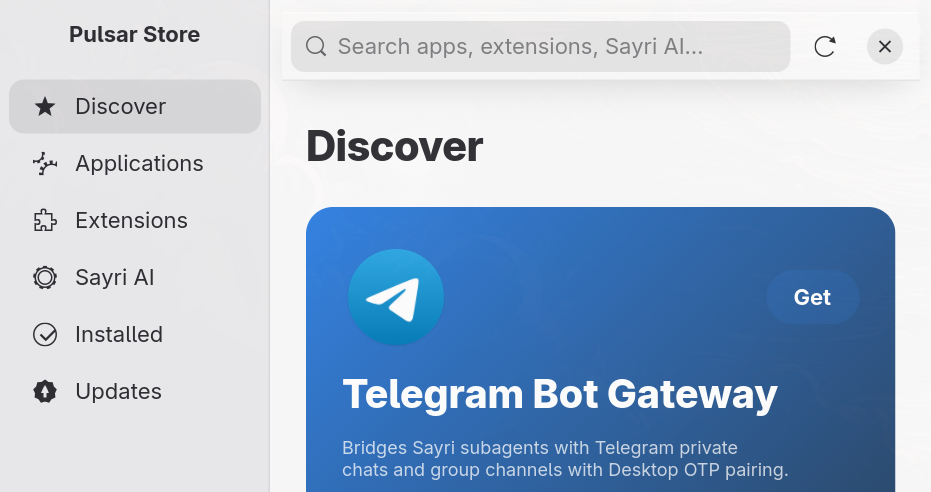
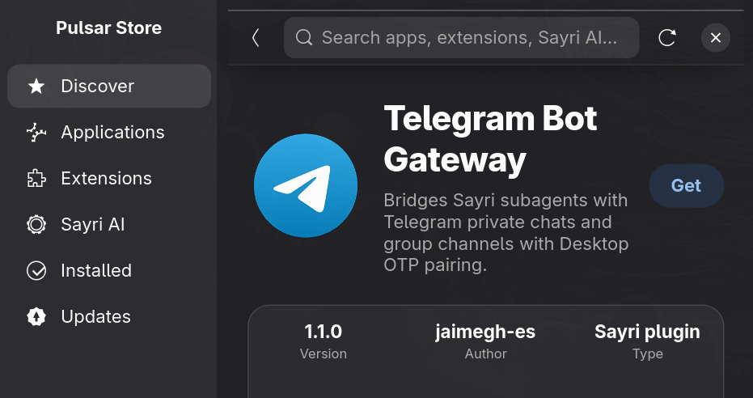

# Design system

Pulsar Store takes inspiration from Apple's Liquid Glass design (see `apple-reference.md`) and builds it on GTK4 and libadwaita. It copies ideas and structure, not Apple artwork, icons, or fonts.

## Layout

The layout follows the Mac App Store (reference screenshots from Apple's App Store, studied for structure only) in the Tahoe style.

- **Floating glass sidebar** on the left, inset from the window edge with a large corner radius: search at the top, Discover, Applications, Extensions, Sayri AI, Installed, and Updates (with a count badge), and the user at the bottom. The selected row is a capsule.
- **Two round glass buttons** float over the content instead of a toolbar bar, as in the Tahoe App Store: back at the top left (only when there is somewhere to go back to), and share at the top right on item pages (it copies a `pulsar://install/<id>` link). There is no title, refresh button, or close button in the content; refresh is Ctrl+R. The top edge is an invisible strip for dragging the window.
- **Window buttons** are red, yellow, and green circles at the top of the sidebar (close, minimize, maximize), as in the picture. This differs from the GNOME convention of buttons on the right; it is deliberate.
- **Content scrolls underneath both**, so the glass has something to blur.
- **Discover:** a wide hero banner (text on a dark fade at the left, artwork at the right), a row of three editorial cards with round artwork, then sections titled with a "See All" link, each a grid of compact app rows (icon, name, subtitle, Get capsule).
- **Category pages** show a pair of editorial cards above the full list of rows.
- **Item page** (the Tahoe product page): a large squircle icon at the left; beside it the name (28 px, bold), the summary in gray, and a solid accent **Get / Open** capsule with Uninstall as a quiet link. A hairline, then the facts strip, a hairline, large rounded screenshots side by side that scroll sideways, and a platform line ("Linux"). The sections (About, Security Audit, documentation, package files) follow.
- **Facts strip:** cells separated by hairlines, each a small uppercase label, a large value, and a line of detail: Security (score out of 100), Version (and whether it is installed), Type (and how it is delivered), Developer (an icon and the name), Language (the first language and how many more the catalog has), and Size. A cell appears only when the catalog has the data.

## Layers

- **Content layer:** pages, lists, cards. Flat, no glass.
- **Navigation layer:** the floating sidebar and the round back and share buttons. These are the only glass surfaces. Never put glass on content, and never stack glass on glass.

## Tokens

Numeric tokens live in `src/ui/tokens.rs`. Colors live in `assets/css/light.css` and `assets/css/dark.css` as `@store_*` names, built on libadwaita's named colors so the system accent color and light/dark setting apply. A test checks that both theme files define every token and that components use only defined ones.

| Group | Names |
|---|---|
| Spacing | `SPACE_XS` 4, `SPACE_S` 8, `SPACE_M` 12, `SPACE_L` 16, `SPACE_XL` 24, `SPACE_XXL` 32 |
| Radii | window 26, card 22, tile 16, pill 999; app icons use 22.5% of their side |
| Colors | `store_surface`, `store_surface_hover`, `store_hairline`, `store_text_dim`, `store_surface_flat`, `store_glass_tint`, `store_glass_edge`, `store_glass_edge_dim`, `store_glass_shadow`, `store_hero_scrim`, `store_accent_text` |

Controls inside a rounded surface use concentric radii: `concentric(outer, inset)` returns `outer - inset`.

## Type

The app uses the system font (libadwaita's default, Inter on most Pulsar OS installs). No proprietary font is bundled. Titles use weight 800, section titles 700, captions 12 px in the dim text color.

## Glass

`GlassSurface` (`src/ui/glass.rs`) blurs the content behind it, adds a tint, a lit top edge, and a soft shadow. GTK cannot bend light, so this approximates Liquid Glass without true lensing. It falls back to a flat translucent surface when high contrast is on or `PULSAR_STORE_FLAT_GLASS=1` is set.

## Widgets

| Widget | File | Notes |
|---|---|---|
| App row | `ui/widget/item_row.rs` | Compact: icon, name, subtitle, install button. Used in lists. |
| Hero banner | `ui/widget/hero.rs` | Wide banner for the featured item. |
| Editorial card | `ui/widget/feature_card.rs` | Label, title, description, round artwork. |
| Item tile | `ui/widget/item_tile.rs` | Boxed variant of the row; also provides `make_openable`. |
| Card | `ui/widget/card.rs` | Larger; the hero variant uses the accent gradient. |
| Install button | `ui/widget/install_button.rs` | Get, progress ring, Open, Update. Tap the ring to cancel. |
| Progress ring | `ui/widget/progress_ring.rs` | Determinate, or spinning when unknown. |
| Info grid | `ui/widget/info_grid.rs` | Value over label cells. |
| Item grid | `ui/widget/item_grid.rs` | Virtualized; builds only visible rows. |

## Motion

Durations: 150 ms fast, 250 ms base, 350 ms slow, never over 400 ms. Pages fade in; the navigation view slides pages. Tiles and cards dim slightly while pressed. Everything respects the system "animations" setting (`gtk-enable-animations`).

## Regenerating screenshots

`scripts/screenshot-all.sh` opens each page in the real app on a Hyprland session and saves images to `docs/screenshots/`. Review the diff by eye.
