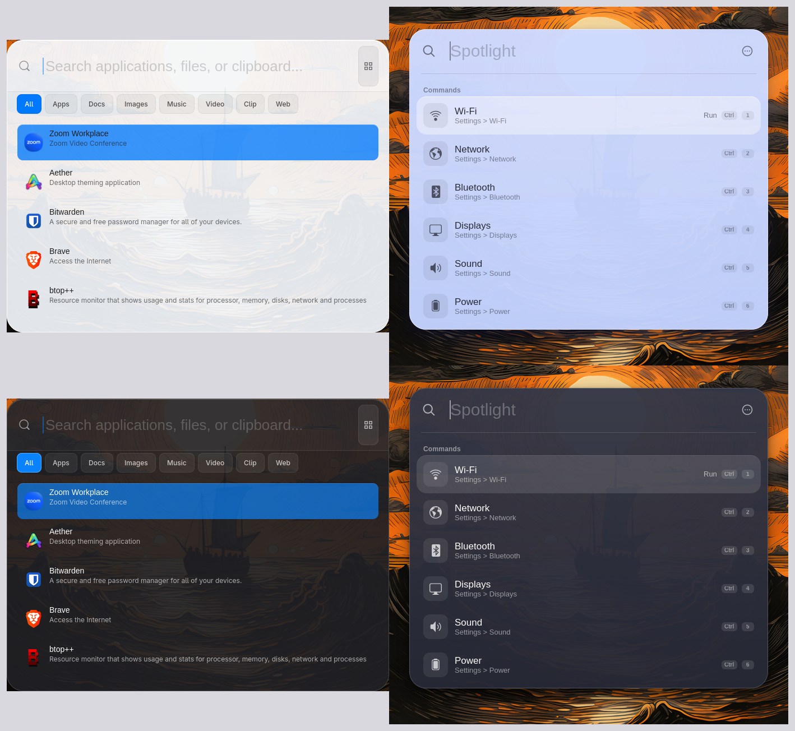
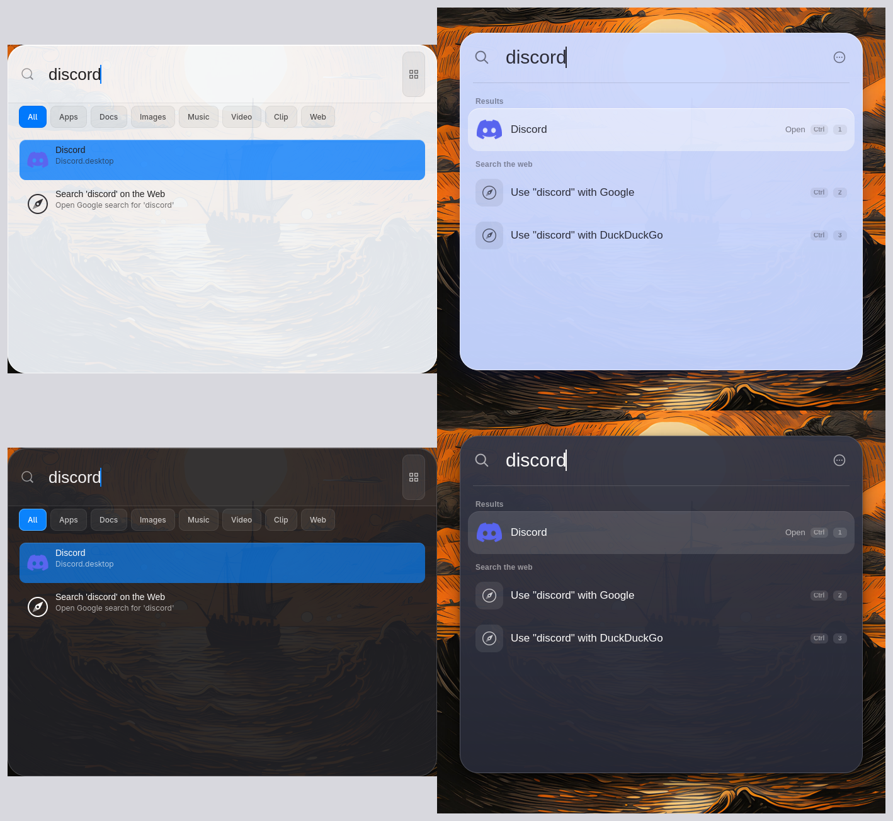
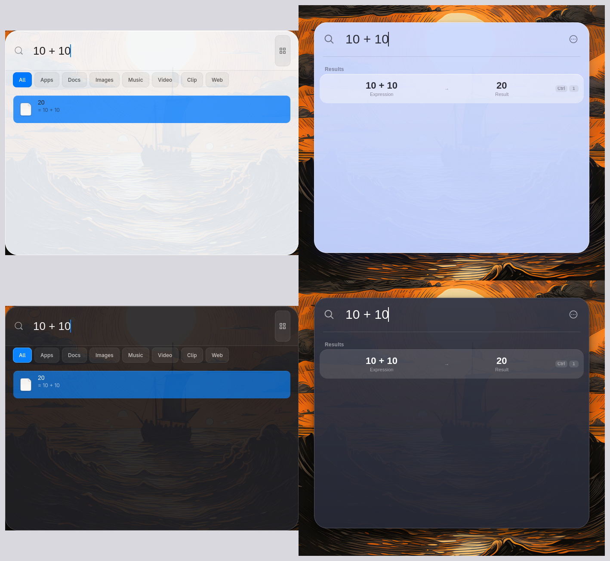
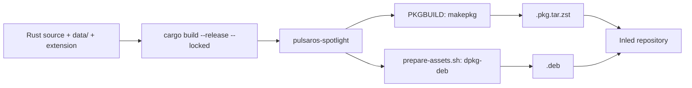

# Pulsar OS Spotlight

A fast, keyboard-first launcher for GNOME, styled after macOS 26 (Tahoe) Spotlight and
modeled on the behavior of [oma-cast](https://github.com/typecraft-dev/oma-cast) and
[Vicinae](https://github.com/vicinaehq/vicinae). Written in Rust with GTK4 and libadwaita.

Search apps, files, clipboard history, system settings, a calculator, emoji, snippets,
quicklinks, script commands and open windows from one box.

## Before and after

Same queries, same machine, light and dark. Left: previous version (`main` before this work).
Right: this version.

**Empty search**



**Search `discord`**



**Calculator: `10 + 10`**



| | Before | After |
|---|---|---|
| Look | Blue selection, category buttons, grid toggle | Tahoe glass panel, big light header, soft selection pill |
| Results | One flat list | Sections: Favorites, Suggestions, Commands, Applications; web fallbacks |
| Ranking | Name match | Ranked fuzzy match + frecency + learned search terms |
| Actions | Right-click menu | Ctrl+K action panel, `↵` / `Ctrl+↵` / `Ctrl+Shift+↵` |
| Calculator | Basic math | Units, percentages, dates, time zones, bases, currencies, history |
| Extras | Clipboard history | + script commands, quicklinks, snippets, emoji, window switcher, dmenu |
| Code | Rust + a Python copy | Rust only, with a tested pure-logic core (`src/core`) |

The screenshots were taken on Omarchy, where there is no blur. On GNOME with a blur extension
the panel looks closer to real Spotlight.

## Features

- **Search**: apps, files (Tracker/localsearch), browser history, clipboard history, GNOME commands (70+: Wi-Fi, Bluetooth, dark mode, power, ...).
- **Ranking**: fuzzy matching, frecency (10-day half-life) and learned terms (type `ff`, pick Firefox, and `ff` stays Firefox).
- **Personal**: aliases, favorites with reordering, hide commands (with undo), search history.
- **Modes**: Spotlight, Applications, Files, Actions, Clipboard (`Tab` or `Alt+1..4`).
- **Calculator**: `20% off 50`, `5 ft 3 in to cm`, `3pm london to nyc`, `255 to hex`, `days until christmas`, live currency rates (cached, can be turned off).
- **Script commands**: Raycast-compatible scripts in `~/.config/pulsaros-spotlight/scripts/`.
- **Quicklinks**: `gh rust` opens a URL template with `{query}`.
- **Snippets**: text with `{clipboard}`, `{date}`, `{uuid}`, `{cursor}`, `{argument}` placeholders.
- **Emoji picker**: searchable grid, recents first, skin tones.
- **Window switcher**: lists, focuses and closes windows through the GNOME Shell extension.
- **dmenu mode**: `printf 'a\nb\n' | pulsaros-spotlight --dmenu`.
- **Theme**: follows GNOME dark/light and accent live. No theme setting.

### Keyboard

| Key | Action |
|---|---|
| `↵` / `Ctrl+↵` / `Ctrl+Shift+↵` | Run first, second, third action |
| `Ctrl+K` | Action panel |
| `Tab` / `Shift+Tab`, `Alt+1..4` | Switch mode |
| `Ctrl+1..9` | Pick a result |
| `Ctrl+↑` / `Ctrl+↓`, `PgUp` / `PgDn` | Jump section / page |
| `↑` on empty search | Search history |
| `Esc` / `Shift+Esc` | Back / back to root |
| `Ctrl+Shift+F`, `Ctrl+Alt+↑↓` | Favorite, reorder |
| `Alt+Shift+D` | Hide a command |
| `Ctrl +`, `Ctrl -`, `Ctrl 0` | Zoom |

### Command line

```sh
pulsaros-spotlight                  # open (single instance)
pulsaros-spotlight --hidden         # start in the background
pulsaros-spotlight --keep-open      # do not hide on focus loss (development)
pulsaros-spotlight --dmenu [--prompt TEXT] [--placeholder TEXT]
```

## Dependencies

**Runtime** (Arch / Debian names)

| Needed | Arch | Debian |
|---|---|---|
| GTK 4, libadwaita | `gtk4`, `libadwaita` | `libgtk-4-1`, `libadwaita-1-0` |
| GLib, SQLite, JSON-GLib | `glib2`, `sqlite`, `json-glib` | `libsqlite3-0`, `libjson-glib-1.0-0` |
| File search | `tinysparql`, `localsearch` | `localsearch` or `tracker-miner-fs` |
| Clipboard | `wl-clipboard` | `wl-clipboard` |
| Currency rates | `curl` | `curl` |
| Extension, window list | `gnome-shell` | `gnome-shell` |

**Optional**: `ydotool` (paste fallback), `poppler` / `poppler-utils` (PDF thumbnails), `ffmpeg` (video thumbnails),
`libnotify` (failure notices), `xdg-utils` (open links), `networkmanager` (Wi-Fi commands),
`wireplumber` (volume), `playerctl` (media).

**Build**: Rust (`cargo`), `pkgconf`, and the GTK 4 / libadwaita / SQLite development packages
(`libgtk-4-dev libadwaita-1-dev libsqlite3-dev pkg-config` on Debian).

**Rust crates**: `gtk4` 0.9, `libadwaita` 0.7, `gdk-pixbuf` 0.20, `zbus` 4.4, `rusqlite` 0.32, `serde`, `serde_json`,
`dirs`, `mime_guess`, `urlencoding`, `regex`, `lazy_static`, `libc`.

## Build and install

### From source (any distro)

```sh
cargo build --release --locked
cargo test                     # one known failure: thumb_generates_scaled_from_real_image
                               # (needs /usr/share/backgrounds/pulsar-os-tahoe.png)
./target/release/pulsaros-spotlight --keep-open
```

The app looks for styles in `/usr/share/pulsaros-spotlight`, then `~/.local/share/pulsaros-spotlight`,
then `data/` in the source tree, so a plain run from the repo works.

### Local install for testing (GNOME)

From the repository root (`PKG/`):

```sh
./install-spotlight-local.sh   # builds, installs to ~/.local, enables the Shell extension
```

On Wayland, log out and back in so GNOME Shell loads the extension.

### Arch Linux

```sh
cd arch/pkgbuilds/pulsaros-spotlight-launcher
makepkg -si                    # builds, runs cargo test via check(), installs

# from the repository's arch/ folder, for the Inled repo:
./package-and-deploy.sh pulsaros-spotlight-launcher            # build the .pkg.tar.zst
./package-and-deploy.sh pulsaros-spotlight-launcher --deploy   # build and deploy
```

The PKGBUILD builds from this repository (`$startdir/../../..`), so run it inside the full checkout.

### Debian / Ubuntu

```sh
./prepare-assets.sh /tmp/stage             # stage the files (used by the packager)

# from the repository root:
./package-and-deploy.sh pulsaros-spotlight-launcher            # build the .deb
./package-and-deploy.sh pulsaros-spotlight-launcher --deploy   # build and deploy
```

### Build workflow



## Files and data

| Path | Content |
|---|---|
| `~/.config/pulsaros-spotlight/config.json` | Settings (zoom, `hide_on_focus_loss`, `currency_rates`, clipboard limits) |
| `~/.config/pulsaros-spotlight/scripts/` | Script commands |
| `~/.local/share/pulsaros-spotlight/db/` | Frecency, aliases, favorites, history, quicklinks, snippets, calculator history |
| `~/.cache/pulsaros-spotlight/currencies.json` | Cached exchange rates |

## Project layout

```
src/core/         pure logic, no GTK, unit tested (ranker, frecency, root search, commands,
                  scripts, quicklinks, snippets, emoji, windows, dmenu, shortcuts, store)
src/calculator/   calculator engine, currencies, history
src/ui/           GTK4 window, results, dmenu window, extras
src/windows_client.rs   D-Bus client for the window list
data/             CSS (base, dark, light, liquid-glass), icons, emoji data, .desktop
gnome-shell-extension/  top-bar icon, paste via virtual keyboard, window list D-Bus service
cli/              helper scripts (launcher mode and Super-key remap)
docs/             plans, tickets and screenshots
```

Design notes and tickets: [`docs/spotlight-tahoe-plan.md`](docs/spotlight-tahoe-plan.md),
[`docs/oma-cast-parity.md`](docs/oma-cast-parity.md), [`docs/vicinae-features.md`](docs/vicinae-features.md),
[`docs/arch-packaging.md`](docs/arch-packaging.md).

## Known limits

- No real blur from GTK4. Use a GNOME blur extension for the glass effect.
- Window switcher, paste from snippets and emoji, and the Shell extension are tested on GNOME only.
- `{cursor}` in snippets is parsed but the cursor is not moved after paste.

## License

GPL-3.0-or-later. oma-cast and Vicinae are behavior references only; no code was copied from them.
