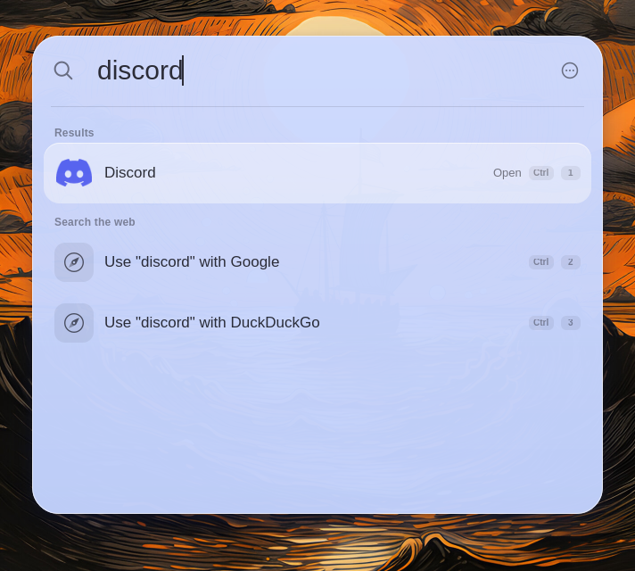
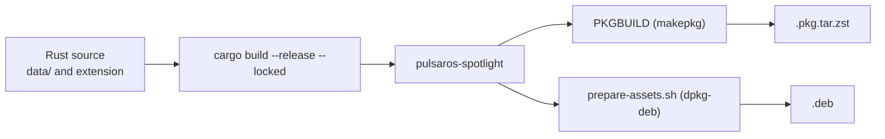

# Pulsar OS Spotlight

A fast, keyboard-first launcher for GNOME, styled after macOS 26 (Tahoe) Spotlight.
Written in Rust with GTK4 and libadwaita.

One search box for apps, files, clipboard history, system settings, a calculator, emoji,
snippets, quicklinks, scripts and open windows.



**Contents:** [Quick start](#quick-start) · [What it does](#what-it-does) · [Keyboard](#keyboard) ·
[Install](#install) · [Dependencies](#dependencies) · [Build and package](#build-and-package) ·
[Configuration](#configuration) · [Project layout](#project-layout) · [Contributing](#contributing) ·
[Before and after](#before-and-after)

## Quick start

```sh
cargo build --release --locked
./target/release/pulsaros-spotlight --keep-open
```

Type to search. `Enter` runs the first result. `Ctrl+K` shows more actions for the selected result.
`Esc` goes back, then closes.

`--keep-open` stops the window from closing when it loses focus, which is handy while developing.

## What it does

| You type | You get |
|---|---|
| `discord` | The app, ranked by how often you use it, plus web search rows |
| `20% off 50`, `5 ft 3 in to cm`, `3pm london to nyc` | An inline calculator card (units, dates, time zones, currencies) |
| `dark`, `wifi`, `lock` | System commands with their current state (70+ built in) |
| `gh rust` | A quicklink: opens your URL template with `rust` filled in |
| a snippet keyword | Your saved text, pasted with `{date}`, `{clipboard}`, `{uuid}` placeholders |
| `emoji` | A searchable emoji grid, recents first |
| anything | Matching files (via Tracker/localsearch), clipboard items, open windows, your own scripts |

It also learns: type `ff` and pick Firefox once or twice, and `ff` keeps meaning Firefox.

**Modes** narrow the search. Switch with `Tab` or `Alt+1..4`: Spotlight (everything), Applications,
Files, Actions, Clipboard.

**Personal touches:** give any result an alias, pin favorites, hide commands you never use
(with undo), and press `↑` on an empty search to see your history.

**Extend it:**

- **Scripts**: put executable files in `~/.config/pulsaros-spotlight/scripts/`. They use Raycast-style
  header comments (`@raycast.title`, `@raycast.mode`, `@raycast.argument1`, ...).
- **Quicklinks and snippets**: create them from the launcher ("Create Quicklink", "Create Snippet").
- **dmenu mode**: `printf 'a\nb\n' | pulsaros-spotlight --dmenu` prints the pick to stdout.

## Keyboard

| Key | Action |
|---|---|
| `Enter`, `Ctrl+Enter`, `Ctrl+Shift+Enter` | Run the first, second, third action |
| `Ctrl+K` | Action panel for the selected result |
| `Tab` / `Shift+Tab`, `Alt+1..4` | Switch mode |
| `Ctrl+1..9` | Pick the numbered result |
| `Ctrl+↑` / `Ctrl+↓` | Jump between sections |
| `↑` on an empty search | Search history |
| `Esc` / `Shift+Esc` | Back / back to the start |
| `Ctrl+Shift+F`, `Ctrl+Alt+↑↓` | Favorite, reorder favorites |
| `Alt+Shift+D` | Hide a command |
| `Ctrl +`, `Ctrl -`, `Ctrl 0` | Zoom in, out, reset |

Command line: `pulsaros-spotlight [--hidden] [--keep-open] [--dmenu [--prompt TEXT] [--placeholder TEXT]]`

## Install

| You are on | Do this |
|---|---|
| Arch Linux | `cd arch/pkgbuilds/pulsaros-spotlight-launcher && makepkg -si` |
| Debian / Ubuntu | Build the `.deb` with the repository packager (see [Build and package](#build-and-package)) |
| Any GNOME, for testing | `./install-spotlight-local.sh` from the repository root |
| Anything else | `cargo build --release --locked`, then run the binary |

On Wayland, log out and back in after installing so GNOME Shell loads the extension.

## Dependencies

**To run** (Arch / Debian names):

| Needed for | Arch | Debian |
|---|---|---|
| UI | `gtk4`, `libadwaita` | `libgtk-4-1`, `libadwaita-1-0` |
| Libraries | `glib2`, `sqlite`, `json-glib` | `libsqlite3-0`, `libjson-glib-1.0-0` |
| File search | `tinysparql`, `localsearch` | `localsearch` or `tracker-miner-fs` |
| Clipboard | `wl-clipboard` | `wl-clipboard` |
| Currency rates | `curl` | `curl` |
| Shell extension, window list | `gnome-shell` | `gnome-shell` |

**Optional:** `ydotool` (paste fallback), `poppler` (PDF thumbnails), `ffmpeg` (video thumbnails),
`libnotify` (failure notices), `xdg-utils` (open links), `networkmanager` (Wi-Fi commands),
`wireplumber` (volume), `playerctl` (media).

**To build:** Rust (`cargo`), `pkgconf`, and the development packages for GTK 4, libadwaita and SQLite
(Debian: `libgtk-4-dev libadwaita-1-dev libsqlite3-dev pkg-config`).

<details>
<summary>Rust crates</summary>

`gtk4` 0.9, `libadwaita` 0.7, `gdk-pixbuf` 0.20, `zbus` 4.4, `rusqlite` 0.32, `serde`, `serde_json`,
`dirs`, `mime_guess`, `urlencoding`, `regex`, `lazy_static`, `libc`.

</details>

## Build and package



**From source**

```sh
cargo build --release --locked
cargo test
```

`cargo test` has one known failure, `thumb_generates_scaled_from_real_image`, which needs the
Pulsar OS wallpaper at `/usr/share/backgrounds/pulsar-os-tahoe.png`.

The app finds its styles in `/usr/share/pulsaros-spotlight`, then `~/.local/share/pulsaros-spotlight`,
then `data/` in the source tree, so running straight from a checkout works.

**Arch Linux**

```sh
cd arch/pkgbuilds/pulsaros-spotlight-launcher
makepkg -si          # builds, runs the tests (check), installs
```

The PKGBUILD reads sources from this checkout (`$startdir/../../..`), so run it inside the full
repository. To build and publish through the Inled repository, run from `arch/`:

```sh
./package-and-deploy.sh pulsaros-spotlight-launcher            # build only
./package-and-deploy.sh pulsaros-spotlight-launcher --deploy   # build and deploy
```

**Debian / Ubuntu**

```sh
# from the repository root
./package-and-deploy.sh pulsaros-spotlight-launcher            # build the .deb
./package-and-deploy.sh pulsaros-spotlight-launcher --deploy   # build and deploy
```

The packager calls `prepare-assets.sh`, which builds the binary and stages the files under `/usr`.

## Configuration

| Path | What is stored |
|---|---|
| `~/.config/pulsaros-spotlight/config.json` | `zoom`, `hide_on_focus_loss`, `currency_rates`, clipboard limits |
| `~/.config/pulsaros-spotlight/scripts/` | Your script commands |
| `~/.local/share/pulsaros-spotlight/db/` | Usage history, aliases, favorites, quicklinks, snippets, calculator history |
| `~/.cache/pulsaros-spotlight/currencies.json` | Cached exchange rates (set `currency_rates` to `false` to stop fetching) |

The theme follows GNOME: dark or light, and the accent color, live. There is no theme setting.

## Project layout

```
src/core/               Pure logic, no GTK, unit tested: ranking, usage history, search sections,
                        system commands, scripts, quicklinks, snippets, emoji, windows, dmenu,
                        shortcuts, JSON store
src/calculator/         Calculator engine, units, dates, time zones, currencies, history
src/ui/                 GTK4 window, result rows, dmenu window, quicklink/snippet/emoji views
src/windows_client.rs   D-Bus client for the window list
data/                   CSS (base, dark, light, liquid-glass), icons, emoji data, .desktop file
gnome-shell-extension/  Top-bar icon, paste through a virtual keyboard, window-list D-Bus service
cli/                    Helper scripts (launcher mode, Super-key remap)
arch/, DEBIAN/          Packaging
docs/                   Plans, tickets and screenshots
```

The rule of thumb: logic goes in `src/core` with tests, widgets go in `src/ui`.

## Contributing

1. Build and test: `cargo build --release --locked && cargo test`.
2. Run with `--keep-open` so the window stays up while you work.
3. Keep GTK out of `src/core`, so it stays testable without a display.
4. Add or update tests with the code you change.

Design notes and tickets are in [`docs/`](docs/), for example the
[visual plan](docs/spotlight-tahoe-plan.md) and the [Arch packaging notes](docs/arch-packaging.md).

**Known limits**

- GTK4 cannot blur what is behind the window. Install a GNOME blur extension for the glass effect.
- The window switcher, snippet and emoji paste, and the Shell extension are only tested on GNOME.
- `{cursor}` in a snippet is parsed, but the cursor is not moved after pasting.

## Before and after

Same queries, light and dark. Left: the previous version. Right: this version.
These screenshots were taken without blur, so the panel is more transparent than it will be on GNOME
with a blur extension.

**Empty search**


**Search `discord`**


**Calculator: `10 + 10`**


| | Before | After |
|---|---|---|
| Look | Blue selection, category buttons, grid toggle | Glass panel, large header, soft selection |
| Results | One flat list | Sections plus web-search rows |
| Ranking | Name match | Fuzzy match, usage history, learned search terms |
| Actions | Right-click menu | `Ctrl+K` panel and `Enter` variants |
| Calculator | Basic math | Units, percentages, dates, time zones, currencies |
| Extras | Clipboard history | Scripts, quicklinks, snippets, emoji, window switcher, dmenu |
| Code | Rust plus a Python copy | Rust only, with a tested core |

## License

GPL-3.0-or-later.
